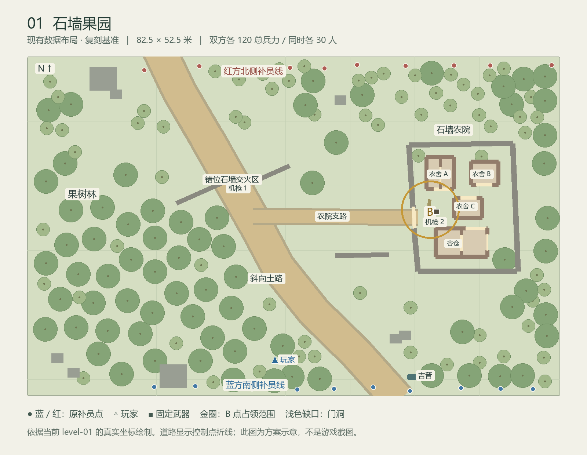

# 第一关「石墙果园」复刻方案

2026-09-26｜关卡大师｜用户已授权制作，当前进入实施。本文保留审批时的规划与候选参数；最终实现及检查状态以 [可玩首关记录](level-01-playable.md) 为准。

目标：在当前 Godot 项目 `LittleBattlefield-Ink` 中，用地编大师维护的预制体与地形表现，重建小小战地当前正式第一关，并接通一局可以玩完的战斗。按用户后续明确提出的方向，在原二维布局骨架上增加高低差、坡道与战壕。统一使用 `res://proving_ground.tscn`，保留原角色骨架、2.5D 相机、最新枪械/载具表现及 E 交互、F 上下车。

## 1. 已核实的复刻基准

已阅读任务「枪械动作大师」（`01a0d12f-3766-7b10-a3f3-d7c5b3d3a9a5`）的完整分页记录，以及「地编大师」（`01a0db47-d120-70f3-a574-c01daa5a2925`）现有记录与项目代码。

当前正式第一关是启用的 Scene Plan `level-01`「石墙果园」。旧版 `src/levels.js` 的规划骨架经 `src/scenePlanLevel.js` 覆盖后才是正式关卡。`src/prototypes/level01.js` 的「林间公路遭遇战」是另一份原型，不作为本次布局基准。

新旧项目的 `scenes.json`、`prefabs.json`、`components.json` 经结构化比较一致。Godot 的 `data/original/compiled-scenes.json` 来自 `assembleScenePlan({}, plan, library)`，缺少正式 `LEVELS[0]` 的基础配装等上下文，不能单独充当全部战斗规则。

| 项目 | 当前正式第一关 |
| --- | --- |
| 地图 | 3300 × 2100 原坐标；40 单位/米，即 82.5 × 52.5 米 |
| 路网 | 西北至东南斜向果园土路，东向支路通往农院 |
| 主要空间 | 果树林、3 段错位田间石墙、石墙围院、3 栋农舍、1 座谷仓 |
| 原始组成 | 0 个预制体实例；52 个散装组件（33 石/砖墙、3 沙袋、8 岩石、8 门）；140 棵阔叶树；6 个地表区域/路径 |
| 出生 | 蓝方南侧补员、红方北侧补员，各 10 个点；红方初始守军已布在田间石墙/道路/农院，并非全部从北端起步；玩家出生约 (1534.96, 1880.18) |
| 兵力 | 双方初始各 30，总兵力各 120，同时上场目标各 30；蓝方包含玩家 |
| 据点 | 东侧农院 B 点 (2498, 949)，半径 180 单位，即 4.5 米，初始中立 |
| 载具 | 1 辆中立武装吉普，位于南侧 |
| 固定武器 | 2 挺中立重机枪，分别位于田间石墙和 B 点附近；原配置不由 AI 自动操控 |
| 特种装备 | 蓝方计划 3 名、红方 2 名 Portable Mortar 使用者，需连同正式配装规则迁移 |

图仅用于核对原二维布局；直接由原坐标绘制，道路以控制点折线示意，不是游戏截图或画面验收结果。下文新增的高差方案尚未画入此图。

## 2. 当前 Godot 已具备与未具备

已具备：F8 原地图载入、场景 JSON 编辑/保存、原武器与弹药数据、车辆与固定武器、人物动作、墙体局部破坏、爆炸开口、支撑失效坍落、通行/挡弹/寻路同步、建筑切顶，以及地编大师的地表/树木/建筑材质表现。原库 52 个预制体、63 个组件；首次核查时另有 5 个地貌预制体、5 个组件，合计57/68。后续住宅与树石库继续扩充，57/68仅为首次核查记录，不代表最新全库数量。

仍缺：

- 统一入口仅生成玩家与红方靶兵，忽略原蓝方单位、据点和双方有限补员规则；默认玩家无敌、靶兵无限补充，不能视为第一关已完成。
- AI 主要针对玩家，尚未形成两支军队互相选敌、推进、争点与守点的循环。
- 首关建筑全为散装墙段；只有 `building.*` 预制体实例会自动生成屋顶/窗洞并建立建筑归属。直接载入旧 JSON 不会得到完整农舍表现。
- 通用农舍、谷仓的门位/尺寸与第一关不同，直接整体缩放会改变通行。
- 当前道路绘制尚未完整消费原 `pathMode=spline`、`surface`、`shoulderWidth` 等参数；大小阔叶树共用主要造型分支，需要核对树冠体积与遮挡。

## 3. 推荐落地方案

### 保留布局骨架，增加三维战术地形

以原地图尺度、140棵树的分布、石墙、建筑轮廓、门位、据点与出生/武器位置为布局基准，新增高度层。用户已提出增加高低差、坡度及战壕，因此撤销上一版“首关保持平地”的设计限制。原导入数据不变；新地形及确有必要的树位/掩体局部调整仅进入 Godot 派生计划，并记录调整原因。建筑轮廓与门位保持原基准，原风格仍是林地果园，雪地和沙漠不进入首关。

关卡节奏沿现有地形成立：南侧集结 → 果树林和错位石墙交火 → 通过土路支路或林地接近农院 → 争夺 B 点。保留沿围墙绕行与破墙另开入口的选择，不把全部 AI 压进唯一门洞。

把散墙按 `house-a-*`、`house-b-*`、`house-c-*`、`barn-*`、`compound-*` 分组，转为复用的预制体实例，记录原 ID 到实例子部件的映射。原始 `data/original` 保留为导入基线；Godot 首关使用独立派生计划，避免下一次同步覆盖新制作内容。五个首关建筑/农院 ID 已由地编大师确认，见第4节。

新加的窗洞会影响射线和掩蔽，不能因换成建筑预制体而自动到处开窗。首关建筑实例显式设置 `godot3d.windows=false`，原有门洞写入专用模板；新增窗洞作为明确的三维适配项逐处检查。屋顶与前墙显示裁切不能取消真实挡弹。

### 新增高低差、坡度与战壕（用户后续要求）

以下是首轮设计目标与候选区域，不是已经落地或实测通过的数值。高度均相对于原平地 y=0；坡度以角度表示。

| 位置 / 地形 | 首轮建议 | 战术用途与约束 |
| --- | --- | --- |
| 西侧果园低丘 | 首版优先高1.5m，最多2m；两处缓坡目标8–12°，每处所需水平坡长约7.1–14.3m，平台与过渡另计；约束最终网格局部坡度 | 提供观察和侧射前沿的机会；上坡/露头会暴露，另一侧可绕近，不能从单个坡顶俯射整个B点或双方出生区 |
| 果园中南段折线战壕 | 深1.2–1.4m，沟底净宽2–2.4m；主沟深段沿中心线约18–22m，另接两条各6–8m侧坡口，坡口占地单独计算；拐角加宽，沟沿局部护壁与射击踏步 | 提供受掩护的步兵接近路线；沟底与踏步的暴露/开火能力按真实枪口和沟沿检查，不能仅凭沟深判断；沟不直通B点，接近据点仍需离沟穿越一段可交火区域 |
| 农院外侧浅坡与低土埂 | 局部起伏0.4–0.8m，放在侧翼空地；西门接驳面、房屋地基、B点平台及两挺机枪脚下维持y=0 | 打断长距离贴地射线，产生蹲伏接近与低处绕行；不能整圈包住农院、堵门或把坡堆到约1.1m石墙脚下而抵消掩护高度 |

低丘不必使用当前山体的固定“南缓北陡”形状；需要可调的坡向、坡长与过渡，避免把演武场3.4m山体原样搬来。战壕采用浅折线或错位支段，转弯打断长距离沿沟扫射；主行走路线上至少有两个可双向步行的出入口，优先再留一个中段侧向退出点。梯子可作为玩家捷径，但不能成为AI进出沟的唯一途径。

尺寸口径经地编再次核对：1.5m升高的12°/8°线性坡分别需7.06/10.67m水平展开，2m升高则需9.41/14.23m；完整smoothstep坡的峰值坡度可达平均坡度1.5倍，所以不能用平均角度代替局部坡度验收。沟底净宽另加两侧各0.75–1m沟坡后，总宽约3.5–4.4m；转角先按中心线半径2–2.5m并额外加宽。沟口顶部保留1–1.5m平缓落脚区。空间不足时缩短等深主沟或降低丘高，不能压短坡道却保留原缓坡角度承诺。

初步放置候选（均为原二维坐标，仅用于占地核对，尚未写入关卡）：低丘范围约(60,560)–(840,1440)，约19.5×22m；主沟中心线(1030,1760)→(1030,1480)→(1280,1370)→(1200,1120)，两处侧坡分别接(1280,1800)与(930,1060)。后续需要按圆滑转角、真实道路样条、平台保平带、树位和车辆扫掠修正；此候选不等于通行/战术已验收。

候选平面测算：主沟折线中心线约20.39m，两条侧坡约6.33m/6.91m；按4.4m沟总宽对原道路控制点折线及原路肩测算，最小余量约0.66m。该余量较小，下一步须优先校正靠主路一端；未计真实样条弯曲、拐角加宽与整车扫掠，不能据此直接宣布道路无冲突。

主斜路、农院支路，以及吉普原停放位到主路的接驳面，首轮保持连续 y=0 平整车辆走廊。要按实际车身包围范围和转弯扫掠检查路肩，不能只让道路中心线平整。起伏和壕沟不能横切唯一车辆通路；如后续需要车辆跨沟，先补真实承托的桥/涵洞及车辆适配，再启用该路线。

真实高差的交付要求：脚下高度、坡面显示、子弹/爆炸遮挡、投掷物落地和AI通路读取同一地形；沟底能站立、蹲伏、行走，低处射线被沟沿阻挡，踏步能形成暴露与射击的取舍。沟沿护壁/沙袋继续可以打坏、炸开。当前土壤为固定高度地形，墙体破坏与挖土分开处理，首轮不承诺炮弹实时改变沟形。

射击踏步候选高出沟底0.3–0.45m、净宽0.8–1m；用短坡或2–3级不超过0.18–0.20m的小台阶接入。不能放单个0.4m直角台阶却声称可直接步行上去。实体踏步的承托顶面须接入AI寻路/移动，或先仅作为玩家可选站位；不把它设为AI必经路。人物站姿约1.95m，1.2–1.4m沟深不保证头部与所有枪口都在沟沿以下，应分别检验站、蹲、卧以及上踏步的射线。

当前实现限制已查到：车辆会拒绝脚下高度绝对值超过0.04m或坡度超过0.12的采样点；AI为1m网格且不会主动用梯子。因此不能仅删除车辆拦截条件，也不能只给壕沟加梯子就宣称通行完整。沟底先采用2–2.4m净宽，转角/坡口更宽，并验证旋转后的连通性、双向避让和出口落脚。战壕连接与坡道参数由地编补充，关卡侧负责AI通路与选择。

普通林地物件贴地也要接通：旧树/墙的自动foundation目前主要覆盖雪地和沙漠，不能假设加上低丘后果树和石墙就会自动坐稳。新natural树石可以贴地，但不能据此推断旧140棵树已经接通。树根、墙脚、房屋地基、固定武器底座、操作员和弹道必须保持一致；首轮房屋/门槛/机枪平台维持y=0，沿坡墙段需要分段贴地或明确基础，避免悬空和埋入。固定机枪目前也没有本体/操作员/命中盒统一地高偏移，暂不放上低丘。近侧沟沿应能辨识角色与沟内路径，显示裁切不能消除真实碰撞或挡弹。

### 补完整战斗，而非沿用靶场规则

以当前正式 `LEVELS[0]` 的最终结果和实际规则为准，补接：双方单位与配装、有限兵力池、出生点安全检查、阵营选敌、据点推进/防守、死亡接管与胜负 UI。关卡规则独立组织，再接入现有 `proving_world`，不迁回旧八人/百人样板场景。

原规则要点：

- 单兵占中立点需要 7 秒；两人及以上速率为 1.18 倍；双方同时在圈内时争夺进度回退趋零。敌占点先中和再占领，按原规则迁移。
- 蓝方控制全部旗帜即可胜利。本关只有 B 点。
- 全歼胜利要求场上红方为空且波次、补员储备全部耗尽；菜单旧文案“歼灭 30 人”不能作为判定。红方占旗不会立刻判蓝方失败。
- 玩家死亡后接管最近的存活友军；没有可接管友军时失败。原版此时即使存在剩余储备也会失败，复刻首轮保留并在试玩时说明。
- 原代码补员存在可能把玩家另加到 30 名盟友之外的边界问题；方案按配置意图“蓝方 30 人含玩家”实现，避免意外成为 31 对 30。
- 实际补员波间隔0.5秒、每波最多5人，以 `assaultRules.js` 和实际更新循环为准，不沿用规划骨架中残留的 `interval:1`。

AI 首轮验收以行为为主：能互相交战、使用可达路线逼近/守住 B 点、墙被炸开后能改走缺口、不会全部追玩家。沿用原分阵营配装和火力角色；不在此阶段新增职业技能或重做枪械动作。

### 统一入口与试玩

在当前演武场已有 UI 中增加“第一关 · 石墙果园”的入口，进入后显示兵力、B 点状态、进度、胜负和重开；同一 `proving_ground.tscn` 加载不同计划/规则。F8 仍可编辑这一关，F5 重开。调试武器库与正式战斗状态应明确区分，默认正式战斗关闭无敌与无限靶兵补充。

## 4. 交给地编大师的补齐清单

「地编大师」已回复核对并确认本节保形方案、下列五个稳定 ID 与文件分工；首关资产制作尚未开始。以下尺寸从原墙段读出，不用地面贴片近似值替代墙体基准。

| 优先级 / 资产 | 需求与边界 | 建议复用方式 |
| --- | --- | --- |
| 必需：农舍 A/B/C 变体 | A 170×200（4.25×5m），南门100、内部隔墙门100；B 170×145（4.25×3.625m），南门100；C 175×125（4.375×3.125m），北门100。外墙厚24、隔墙厚20原单位 | 复用 brick/房顶/切顶/破坏模块，做 `building.orchard-house-a/b/c`；保留门的偏心位置与隔间 |
| 必需：首关谷仓 | 320×175（8×4.375m），北门130（3.25m），东侧门100（2.5m），内部隔墙门100；外墙厚26、隔墙厚20 | `building.orchard-barn`；保留东侧通路，不能用单门通用谷仓覆盖 |
| 必需：石砌农院组合 | 保留约原 17×20m 不规则四边形、原西门约140（3.5m）；院墙厚34 | 已确认 `rural.orchard-stone-yard`；复用原 `wall.stone` 和开口机制 |
| 必需：原土路适配 | 主路194宽（4.85m），支路82宽（2.05m）；原路肩224/104；恢复原样条与道路表面语义 | 由地编侧完善通用道路采样与表现，关卡仅提供原路径数据 |
| 需补表现：石墙 | 石块、勾缝与破面区别于混凝土，细节严格随存活墙格消失 | 扩展 `wall.stone` 的既有材质/几何分支，不替换为不可破坏整模 |
| 必需：果园大小树 | 原 72 棵普通阔叶树、68 棵小阔叶树；地编确认当前默认高度均为3.2m且同一主造型，需要两档冠幅/高度 | 完善现有 `tree.broadleaf` / `tree.broadleaf-small`，保留树干破坏；不另造一套树系统 |
| 可直接复用 | 沙袋、岩石、土/草地基础、现有枪械与载具表现、墙格破坏、砖墙和屋顶模块 | 不要求重复生产 |
| 可后置 | 农具杂物、落果、远景装饰、门扇开合、更多屋顶样式、树冠遮挡淡化细调 | 首先完成首关空间和可玩的战斗循环；树冠遮挡按用户试玩反馈调整 |

地编大师已提交[首关高差补充资产契约](level-01-terrain-asset-contract.md)。以下额外资产接口与几何规则已纳入主方案，均尚未注册实现，不混同于已确认的五个建筑/农院预制体：

- 可调低丘/缓坡：高、坡向、坡长、过渡宽度和局部平整面；优先扩展现有共享地形模块。
- 战壕直段、折角与接头：沟底净宽/深度独立配置，连接后不能出现沟底台阶、封口或重复挖深。当前 `terrain_surface.analytic` 仅读取前两个点，多个沟段直接重叠会累加深度，需先补连接逻辑。
- 战壕坡道口、射击踏步与可破坏护壁：端坡长度可调，坡口/转角可加宽，踏步拥有真实承托与通行；梯子为可选部件。
- 普通林地的地面贴合与道路保平带：为树石/墙脚补贴地，平地道路走廊保持真实宽度，和地形采样共用数据。

预留接口：`landform.low-hill`、`landform.trench-network`、`landform.level-pad`、`defense.trench-firing-step`、`defense.trench-revetment`。原平面坐标/路径宽仍以40原单位/米换算一次；新增深度、沟底净宽、坡长等字段明确使用米。高度构造顺序为基础丘坡→整组沟网一次开挖并集→道路/平台保平约束，同组沟段不得高度累加；保平约束把沟路截断时必须报告冲突。

特别注意：通用 `building.farmhouse` 为500×360，原门宽74。将其 X 缩到170，会把门宽缩到约25原单位（0.63m），远小于首关100（2.5m），不能用非等比缩放糊过去。`rural.fenced-yard` 是木围栏组合，也不能直接代替石墙农院。

协作边界：关卡大师负责原布局拆组、关卡派生数据、战斗规则/部署/AI/目标/HUD和统一入口接线；地编大师负责可复用预制体变体、道路/树/石墙表现与资产契约。地编侧拟新增 `scripts/orchard_prefabs.gd`、`scripts/terrain_paths.gd`、`scripts/terrain_landforms.gd`、`scripts/trench_prefabs.gd`，窄改共享地形、注册、物件基础处理与树参数；地编侧不改关卡计划、规则、部署、AI和HUD。道路样条和路肩统一采样，有高差场景也由 `terrain_surface.gd` 读取同一采样结果。枪械动作大师和载具大师已有并行工作，实施前对共享 `source_catalog.gd`、`proving_world.gd`、`proving_ground.gd` 逐处协调，避免整文件覆盖。

地编核对补充：当前树碰撞仅为0.35m树干，树冠不是阻弹体，也没有专用遮挡淡化；不得将树冠视觉范围自动当作实体墙。原道路的 `surface=track`、原 fill、路肩与中心线也未完整绘制，需由通用道路模块统一消费。当前新增地貌只在默认演武场北侧注册布置，不会自动加进第一关；原始 `data/original` 未修改。

## 5. 实施顺序与交付判据

1. 冻结当前第一关源数据快照、原 ID、配装与规则清单；先核对地编大师的资产交付契约。
2. 将原地图预制化，布置低丘、侧翼浅坡与折线战壕；核对门宽、道路保平带、地形贴合、围院/沟内通路、人物/车辆占位及三维遮挡；补第一关入口。
3. 接通 30 对 30、120 总兵力、阵营 AI、B 点、有限增援、死亡接管和结算，形成完整单局。
4. 必要检查覆盖源数据保真、资源引用、出生可达、门洞与破墙后寻路、沟段连接/双出口、坡面行走/物件贴地、道路整车通行、低处遮弹与踏步开火、兵力与占点/胜负、保存重载和启动；不扩大为自动游玩或截图验收。
5. 在本机打开同一演武场中的第一关，由用户实际玩画面、手感、攻防节奏与载具。60 人在新首关的性能单独评估，旧百人场景成绩和启动 FPS 均不作为首关结论。

验收完成应能从南侧出生，选择沿主路、经低丘侧翼或借战壕接近前沿，和友军推进到农院，用原枪械/吉普/重机枪交战，炸墙形成真实新入口，争点或耗尽敌军取得胜利，死亡能按原规则接管友军，并能够重开同一关。

## 源码证据

- 旧项目：`src/levels.js:35–50`、`src/scenePlanLevel.js:6–14`、`src/map-kit/scenes.json`、`src/Game.js:2042`、`2069`、`2192`、`2203–2248`；`src/campaign.js:28` 存在过时30人胜利文案。
- Godot：`scripts/source_catalog.gd:49–134`（编译与仅提取红靶兵）、`scripts/proving_world.gd:25/64/182/732`（靶场生成/复活/AI）、`scripts/range_editor.gd:40`（场景列表）、`scripts/terrain_art.gd`、`scripts/terrain_ground.gd`、`docs/terrain-prefabs.md`。
- `tools/sync_original.mjs:33` 的空基础关卡编译仅用于导入，正式玩法迁移需补齐基础配装上下文。

路径行号为2026-09-26检查时记录，并行任务可能导致行号变化；以函数名及实际内容定位为准。
